<!-- header:start -->
<div align="center">



<a href="#-quick-start"></a>

<a href="LICENSE"></a>

<a href="https://github.com/ajendras/metaprobe/stargazers"></a>
<a href="https://github.com/ajendras/metaprobe/actions/workflows/ci.yml"></a>

<a href="CONTRIBUTING.md"></a>

**Extracts, analyzes and sanitizes EXIF, IPTC &amp; XMP metadata in PHP with built-in privacy scanning and CLI**

[✨ Features](#-features) • [⚡ Quick start](#-quick-start) • [🧰 Usage](#-usage) • [🧩 Architecture](#-architecture) • [📍 Roadmap](#-roadmap) • [🤝 Contributing](#-contributing)

</div>
<!-- header:end -->

## ✨ Why MetaProbe?

PHP web apps regularly process user images yet lack a unified, security-first tool to extract metadata without leaking GPS, device fingerprints or author info. Existing solutions are either outdated, limited to EXIF, or miss sanitization. MetaProbe targets developers building media managers, upload pipelines, forensic tools and AI-augmented image workflows.

- **Unified extraction** — one call reads EXIF, IPTC and XMP from JPEG, PNG, TIFF, WebP, AVIF and HEIC
- **Built-in privacy scanning** — flags risky fields and returns a 0-100 safety score
- **Smart sanitization** — strips PII while preserving quality, copyright and color profiles
- **Rich, zero-config API** — immutable DTOs, GPS value object, pluggable readers and a beautiful CLI
- **PSR-15 middleware** — drop-in auto-sanitization for uploaded images in any modern PHP framework

## 🎬 Demo

<p align="center"></p>

## 🚀 Features

<table>
<tr>
<td>📸 <b>Unified Extraction</b><br>Single API reads EXIF, IPTC and XMP from JPEG, PNG, TIFF, WebP, AVIF and HEIC in one call</td>
<td>🛰️ <b>GPS Decoder</b><br>Converts DMS coordinates to decimal with Google Maps link generator</td>
<td>🔒 <b>Privacy Scanner</b><br>Flags risky fields and returns a numeric safety score via SecurityReport</td>
</tr>
<tr>
<td>🧼 <b>Smart Sanitizer</b><br>Rewrites images stripping PII while preserving copyright and profiles (GD + Imagick fallback)</td>
<td>🖥️ <b>Rich CLI</b><br><code>probe</code> and <code>sanitize</code> commands with JSON output, pretty tables and verbose reporting</td>
<td>📦 <b>Structured Reports</b><br>Metadata DTO with <code>toArray()</code>, <code>toJson()</code>, typed getters and <code>getPrivacyScore()</code></td>
</tr>
<tr>
<td>🔌 <b>Reader Interface</b><br>Pluggable readers so custom formats can be added by implementing <code>supports()</code> and <code>read()</code></td>
<td>📊 <b>Batch CLI</b><br>Directory scanning with Symfony ProgressBar, per-image reports and CSV summary export for bulk analysis</td>
<td>🌐 <b>PSR-15 Middleware</b><br>Auto-sanitizes image uploads in any PSR-15 framework (Slim, Laminas, Symfony, etc.)</td>
</tr>
<tr>
<td>⚙️ <b>Zero-config Core</b><br>Depends only on PHP extensions; optional Symfony Console for the CLI</td>
<td></td>
<td></td>
</tr>
</table>

## 📦 Installation

**Requirements:** PHP 8.2+, `ext-exif`, `ext-xml`, `ext-gd` (`ext-imagick` recommended for WebP, AVIF and HEIC metadata and sanitization). Symfony Console is required only for the CLI. PSR-15 interfaces are required for the middleware.

```bash
composer require ajendras/metaprobe
```

The CLI is automatically available after installation:

```bash
php bin/metaprobe probe sample.jpg --format=pretty
```

## ⚡ Quick start

```php
<?php

require_once 'vendor/autoload.php';

use MetaProbe\MetaProbe;

$metadata = MetaProbe::probe('photo.jpg');
$report   = MetaProbe::scan('photo.jpg');

echo $metadata->toJson();

if ($gps = $metadata->getGps()) {
    echo "\nGoogle Maps: " . $gps->getGoogleMapsUrl();
}

echo "\nPrivacy Score: " . $report->getScore() . "/100\n";
```

## 🧰 Usage

### Facade usage (recommended)

```php
use MetaProbe\MetaProbe;

$metadata = MetaProbe::probe(__DIR__ . '/uploads/image.jpg');
$report   = MetaProbe::scan(__DIR__ . '/uploads/image.jpg');

$exif = $metadata->getExif();
if (!empty($exif['Camera'])) {
    echo "Camera: " . $exif['Camera'];
}

if ($gps = $metadata->getGps()) {
    echo "GPS: " . (string) $gps;           // 51.5125000,-0.1250000
    echo "\nMap: " . $gps->getGoogleMapsUrl();
}

echo "\nSafety: " . $report->getScore() . "/100";
```

### PSR-15 Middleware (new)

```php
use MetaProbe\MetaProbe;
use Psr\Http\Message\ResponseInterface;
use Psr\Http\Message\ServerRequestInterface;
use Psr\Http\Server\RequestHandlerInterface;

// Register early in your pipeline (Slim, Laminas Mezzio, etc.)
$app->add(MetaProbe::middleware(throwOnFailure: false));

// The middleware automatically detects image/* uploads via
// getUploadedFiles(), sanitizes their temporary files in-place
// using the built-in Sanitizer, then passes the request onward.
// Sensitive metadata never reaches your handlers or storage.
```

### CLI

```bash
# Pretty table output
php bin/metaprobe probe photo.jpg

# JSON output + sanitization
php bin/metaprobe probe photo.jpg --format=json --sanitize
```

### Batch processing

```bash
# Process directory with live progress bar and CSV export
php bin/metaprobe batch ./photos --output=summary.csv

# Recursive scan + sanitization
php bin/metaprobe batch ./uploads -r --sanitize
```

The batch command discovers supported images, shows a real-time progress bar, extracts metadata/privacy scores for every file, writes a detailed CSV report, and can optionally sanitize images in-place.

```php
use MetaProbe\MetaProbe;

// Batch API returns structured summary (no progress bar)
$summary = MetaProbe::batch(__DIR__ . '/photos', recursive: true);

foreach ($summary as $item) {
    echo $item['filename'] . ': ' . $item['privacy_score'] . '/100';
    if (!empty($item['gps_coordinates'])) {
        echo ' (GPS: ' . $item['gps_coordinates'] . ')';
    }
    echo "\n";
}

echo "\nProcessed " . count($summary) . " images.\n";
```

### Sanitization

```php
use MetaProbe\MetaProbe;

// Overwrite original (use with caution)
MetaProbe::sanitize('original.jpg');

// Safe copy
MetaProbe::sanitize('original.jpg', 'clean.jpg');
```

<details><summary>Advanced: custom reader</summary>

```php
use MetaProbe\ReaderInterface;
use MetaProbe\MetaProbe;

class CustomReader implements ReaderInterface
{
    public function supports(string $mimeType): bool
    {
        return $mimeType === 'image/jpeg';
    }

    public function read(string $path): array
    {
        // return normalized metadata array
        return ['custom' => 'value'];
    }
}

$probe = new MetaProbe();
$probe->getReaders(); // inspect or replace
```

</details>

<details><summary>Advanced: working with Metadata DTO</summary>

```php
$metadata = MetaProbe::probe($path);

echo $metadata->toJson();                     // pretty-printed
$data = $metadata->toArray();                 // structured array
$score = $metadata->getPrivacyScore();        // uses Scanner internally
$gps = $metadata->getGps()?->getDecimal();    // ['lat' => 51.5125, 'lng' => -0.125]
```

</details>

## 🧩 Architecture

```mermaid
flowchart TD
    HTTP[HTTP Request] --> Middleware[ImageSanitizationMiddleware<br/>(PSR-15)]
    Middleware -->|detects image/* uploads| MetaProbe[MetaProbe Facade]
    MetaProbe --> Readers[Readers<br/>ExifReader • IptcReader • XmpReader • ImagickReader]
    Readers -->|supports + read| Data[Normalized arrays]
    Data --> Metadata[Metadata DTO]
    Metadata --> Gps[Gps Value Object<br/>fromExif → decimal + Google Maps URL]
    MetaProbe --> Scanner[Scanner<br/>isSensitive + calculateScore]
    Scanner --> Report[SecurityReport<br/>score + risks]
    MetaProbe --> Sanitizer[Sanitizer<br/>GD imagecopy or Imagick stripImage]
    Middleware --> Sanitizer
    MetaProbe --> Console[Console Commands<br/>ProbeCommand • SanitizeCommand • BatchCommand]
    Console -->|Symfony Console| CLI[bin/metaprobe]
```

The `MetaProbe` facade coordinates pluggable readers, assembles an immutable `Metadata` object (with embedded `Gps` when present), then hands it to `Scanner` for privacy analysis or `Sanitizer` for cleaning. The new PSR-15 middleware sits in front of your request handlers, automatically sanitizing any uploaded images before they reach application code. The design is intentionally zero-config while remaining easily extensible via `ReaderInterface`.

## 📁 Project structure

```text
.
├── bin/
│   └── metaprobe                 # CLI bootstrap: registers ProbeCommand, SanitizeCommand & BatchCommand
├── src/
│   ├── MetaProbe.php             # Facade with static probe(), scan(), sanitize(), batch(), middleware() and findImages()
│   ├── Metadata.php              # Immutable DTO with getters, toArray(), toJson(), getPrivacyScore()
│   ├── Gps.php                   # Value object: fromExif(), getDecimal(), getGoogleMapsUrl()
│   ├── ReaderInterface.php       # supports() + read() contract
│   ├── Middleware/
│   │   └── ImageSanitizationMiddleware.php # PSR-15 middleware that auto-sanitizes uploads
│   ├── Readers/
│   │   ├── ExifReader.php        # exif_read_data() + normalization (Camera, Lens, Exposure, GPS)
│   │   ├── IptcReader.php        # getimagesize() + iptcparse() mapping
│   │   ├── XmpReader.php         # APP1 XMP packet extraction via SimpleXML + XPath
│   │   └── ImagickReader.php     # Imagick getImageProperties() for WebP, AVIF, HEIC + normalization
│   ├── Security/
│   │   ├── Scanner.php           # getRisks(), calculateScore(), isSensitive()
│   │   └── Sanitizer.php         # GD imagecopy or Imagick stripImage (now with WebP/AVIF/HEIC)
│   └── Console/
│       ├── ProbeCommand.php      # Symfony command with --format and --sanitize options
│       └── BatchCommand.php      # New: directory scanner with ProgressBar, per-file summary and CSV export
├── tests/
│   └── ProbeTest.php             # PHPUnit tests for Gps, Metadata, Scanner, Sanitizer, facade, batch and middleware
├── examples/
│   └── basic-usage.php           # Runnable demo script using the facade
├── composer.json                 # PSR-4, bin, scripts (test/probe/sanitize/batch)
└── vendor/                       # (after composer install)
```

## 🧪 Testing

```bash
composer test
# or
vendor/bin/phpunit
```

The suite covers GPS DMS-to-decimal conversion, extraction accuracy on fixture images, `Scanner` risk detection and scoring, `Sanitizer` output size and tag removal, full facade integration paths, plus the new `batch()` / `findImages()` methods and the PSR-15 middleware.

## 📍 Roadmap
<!-- roadmap:start -->
- [x] **v0.1.0** — first release: Unified Extraction, GPS Decoder, Privacy Scanner, Smart Sanitizer
- [x] Add WebP, AVIF and HEIC format support via native or Imagick readers
- [x] Batch directory command with progress bar and summary CSV export
- [x] PSR-15 middleware that auto-sanitizes uploaded images in frameworks
- [ ] Steganography detector that flags unusual LSB patterns
- [ ] HTML report generator with interactive metadata tree view
- [ ] OpenAI integration to generate alt-text from extracted context
- [ ] Laravel and Symfony service provider / bundle auto-registration
- [ ] Custom reader plugin system with Composer discovery
- [ ] GitHub Action that scans repo images for embedded GPS data
- [ ] Support for reading embedded JSON-LD and llms.txt sidecar files
- [ ] Performance benchmark suite against 500-image corpus
- [ ] Interactive web UI (single HTML + Tailwind) for drag-and-drop demo

> 🤖 This roadmap is worked through continuously — ideas and PRs welcome!
<!-- roadmap:end -->

## 🤝 Contributing

Contributions are welcome and appreciated! Please read [CONTRIBUTING.md](CONTRIBUTING.md) first and follow our [CODE_OF_CONDUCT.md](CODE_OF_CONDUCT.md). Good-first-issue PRs are especially encouraged — improving test coverage, adding new readers, or polishing CLI output are all great places to start. Open a PR against the `main` branch of ajendras/metaprobe.

## 📄 License

This project is licensed under the [MIT License](LICENSE).

<!-- footer:start -->
<div align="center">

### ⭐ Star history

<a href="https://star-history.com/#ajendras/metaprobe&Date"></a>

If **MetaProbe** saves you time, a ⭐ helps others find it.

Made with ❤️ by [Ajendra](https://ajendra.info)


</div>
<!-- footer:end -->
