<div align="center">


# MetaProbe

**Extract, analyze and sanitize EXIF, IPTC & XMP metadata in PHP with built-in privacy scanning, sanitization and CLI.**

</div>

[](LICENSE)

[](https://github.com/ajendras/metaprobe/stargazers)
[](https://github.com/ajendras/metaprobe/actions/workflows/ci.yml)
[](https://github.com/ajendras/metaprobe)
[](CONTRIBUTING.md)

## Why

PHP web apps regularly process user images yet lack a unified, security-first tool to extract metadata without leaking GPS, device fingerprints or author info. Existing solutions are either outdated, limited to EXIF, or miss sanitization. MetaProbe targets developers building media managers, upload pipelines, forensic tools and AI-augmented image workflows.

## Demo

<p align="center"></p>

## Features

- Unified extraction — one call reads EXIF, IPTC and XMP from JPEG, PNG, TIFF, WebP, AVIF and HEIC
- GPS Decoder — converts DMS coordinates to decimal with Google Maps link generator
- Built-in privacy scanning — flags risky fields and returns a 0-100 safety score via `SecurityReport`
- Smart sanitization — strips PII while preserving quality, copyright and color profiles (GD + Imagick fallback)
- Steganography Detector — analyzes LSB patterns in pixel data and flags statistically unusual randomness
- Rich CLI — `probe` and `batch` commands with JSON output, pretty tables and verbose reporting
- Structured reports — `Metadata` DTO with `toArray()`, `toJson()`, typed getters and `getPrivacyScore()`
- Pluggable readers — implement `ReaderInterface` with `supports()` and `read()`
- Batch CLI — directory scanning with Symfony ProgressBar, per-image reports and CSV summary export
- PSR-15 middleware — drop-in auto-sanitization for uploaded images in any modern PHP framework
- Zero-config core — depends only on PHP extensions; optional Symfony Console for the CLI

## Quick start

```bash
composer require ajendras/metaprobe
```

```bash
php bin/metaprobe probe sample.jpg --format=pretty
```

```php
<?php

require_once 'vendor/autoload.php';

use MetaProbe\MetaProbe;

$metadata = MetaProbe::probe('photo.jpg');
$report   = MetaProbe::scan('photo.jpg');

echo $metadata->toJson();

if ($gps = $metadata->getGps()) {
    echo "\nGoogle Maps: " . $gps->getGoogleMapsUrl();
}

echo "\nPrivacy Score: " . $report->getScore() . "/100\n";

if ($report->hasSteganographyRisk()) {
    echo "\n⚠️  Potential steganography detected (unusual LSB patterns)\n";
}
```

## Usage

```php
use MetaProbe\MetaProbe;

$metadata = MetaProbe::probe(__DIR__ . '/uploads/image.jpg');
$report   = MetaProbe::scan(__DIR__ . '/uploads/image.jpg');

$exif = $metadata->getExif();
if (!empty($exif['Camera'])) {
    echo "Camera: " . $exif['Camera'];
}

if ($gps = $metadata->getGps()) {
    echo "GPS: " . (string) $gps;           // 51.5125000,-0.1250000
    echo "\nMap: " . $gps->getGoogleMapsUrl();
}

echo "\nSafety: " . $report->getScore() . "/100";

if ($report->hasSteganographyRisk()) {
    echo "\n⚠️ Steganography risk: unusual LSB patterns detected";
}
```

Standalone steganography check:

```php
$stego = MetaProbe::detectSteganography('image.jpg');
if (!empty($stego['risks'])) {
    echo "Steganography risks: " . implode(', ', $stego['risks']);
}
```

PSR-15 middleware is available via `ImageSanitizationMiddleware`.

## Roadmap

See [CHANGELOG.md](CHANGELOG.md) for released changes and the [GitHub project](https://github.com/ajendras/metaprobe/issues) for upcoming work.

## Contributing

Please read [CONTRIBUTING.md](CONTRIBUTING.md) and [CODE_OF_CONDUCT.md](CODE_OF_CONDUCT.md) before submitting issues or pull requests. Good first issues are listed in the GitHub issue tracker.

## License

This project is licensed under the MIT License. See the [LICENSE](LICENSE) file for details.

If this project helps you, a ⭐ helps others find it.
